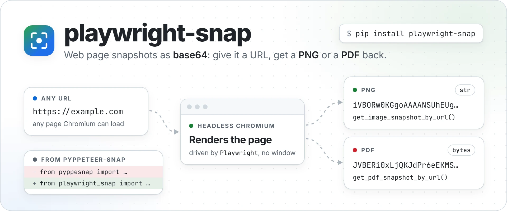
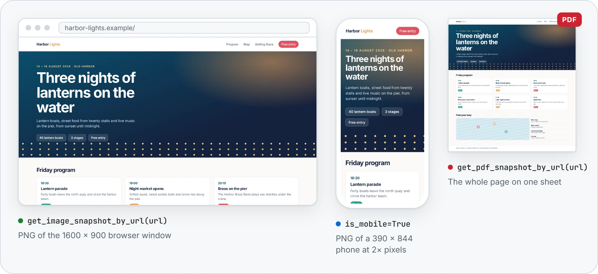

<p align="center">
  <picture>
    <source media="(prefers-color-scheme: dark)" srcset="https://raw.githubusercontent.com/NatLee/playwright-snap/main/docs/images/hero-dark.webp">
    
  </picture>
</p>

<p align="center">
  <a href="https://github.com/NatLee/playwright-snap/actions/workflows/test.yml"></a>
  <a href="https://pypi.org/project/playwright-snap/"></a>
  <a href="https://pypi.org/project/playwright-snap/"></a>
  <a href="https://github.com/NatLee/playwright-snap/blob/main/LICENSE"></a>
</p>

playwright-snap takes a snapshot of a web page and hands it to you: a PNG of what fits in the browser
window, or a PDF of the whole page on a single sheet. It opens the page in a headless Chromium (no
window) through [Playwright](https://playwright.dev/python/), so JavaScript-heavy pages render like they
do in a real browser. One function call, nothing written to disk.

It is the maintained successor of [pyppeteer-snap](https://github.com/NatLee/pyppeteer-snap), which is
built on the no longer maintained Pyppeteer and its old Chromium. The functions have the same names,
arguments and return values, so moving over is a one-line change, see
[Coming from pyppeteer-snap](#coming-from-pyppeteer-snap).

## Installation

```bash
pip install playwright-snap
python -m playwright install chromium
```

The second line downloads the Chromium build that your Playwright version drives, into your user
cache folder. Do it once, and again after upgrading Playwright. Only taking snapshots? Add
`--only-shell` to download just the headless part, which saves about 400 MB of disk space.

On Linux, Chromium also needs some system libraries. Playwright installs them for you on Debian and
Ubuntu (for example in a `python:3.12-slim` Docker image); it needs root:

```bash
python -m playwright install --with-deps chromium
```

playwright-snap works on Python 3.10–3.14, on Linux, macOS and Windows. The latest code is a
`pip install git+https://github.com/NatLee/playwright-snap` away.

## Quick start

```python
from playwright_snap import get_image_snapshot_by_url, get_pdf_snapshot_by_url

png = get_image_snapshot_by_url("https://example.com")  # PNG as base64 str
pdf = get_pdf_snapshot_by_url("https://example.com")    # PDF as base64 bytes

print(png[:20])  # iVBORw0KGgoAAAANSUhE
print(pdf[:20])  # b'JVBERi0xLjQKJdPr6eEK'
```

Here is what you get for the same page (real output, decoded):

<p align="center">
  <picture>
    <source media="(prefers-color-scheme: dark)" srcset="https://raw.githubusercontent.com/NatLee/playwright-snap/main/docs/images/demo-dark.webp">
    
  </picture>
</p>

Rather have the file itself, other window sizes, and an exception when it fails?

```python
from playwright_snap import SnapshotOptions, snap_pdf, snap_png

phone = SnapshotOptions(width=390, height=844, is_mobile=True, device_scale_factor=2)

with open("example.png", "wb") as f:
    f.write(snap_png("https://example.com", phone))   # a 780 x 1688 PNG
with open("example.pdf", "wb") as f:
    f.write(snap_pdf("https://example.com"))          # one sheet, 1600 px wide
```

## API

Everything below is imported from `playwright_snap`.

### Functions

| Function | Returns | When it fails |
|---|---|---|
| `get_image_snapshot_by_url(url, width=1600, height=900, is_mobile=False)` | PNG as base64 `str` | logs why, returns `None` |
| `get_pdf_snapshot_by_url(url, width=1600, height=900, is_mobile=False)` | PDF as base64 `bytes` | logs why, returns `None` |
| `snap_png(url, options=None)` | PNG `bytes` | raises `SnapshotError` |
| `snap_pdf(url, options=None)` | PDF `bytes` | raises `SnapshotError` |

The PNG is what fits in the browser window. The PDF is the whole page, laid out as wide as the window,
on one sheet as long as the page (with the page's print styles, as when you print it).

- `url` needs its scheme: `https://example.com`, not `example.com`.
- The first two are pyppeteer-snap's functions, kept exactly as they were. They log the reason for a
  failure to the `playwright_snap` logger, which Python shows on stderr unless you set up logging.
- Each call starts its own Chromium and closes it again, also when something goes wrong.
- They are synchronous and also work where an event loop is already running, such as a Jupyter
  notebook. In async code, use [`SnapSession`](#snapsession) instead.

### SnapshotOptions

All settings live in one frozen dataclass. Sizes are CSS pixels, times are seconds, and every number must
be greater than 0 (you get a `ValueError` right away otherwise).

| Option | Default | What it does |
|---|---|---|
| `width` | `1600` | width of the browser window; the PNG and the PDF are this wide |
| `height` | `900` | height of the browser window; the PNG is this high |
| `is_mobile` | `False` | lay the page out like a phone browser, honouring its `<meta name="viewport">` |
| `device_scale_factor` | `1` | image pixels per CSS pixel; `2` gives a retina-sharp PNG twice the size |
| `wait_until` | `"load"` | when the page counts as loaded: `"load"`, `"domcontentloaded"`, `"networkidle"` or `"commit"` |
| `navigation_timeout` | `30` | how long the page may take to load |
| `snapshot_timeout` | `120` | how long one whole snapshot may take, starting Chromium included |

`wait_until="networkidle"` helps with pages that keep loading content after the load event.

### SnapSession

For async code, or many pages in a row: one Chromium for all snapshots, which is quicker than starting
one per page.

```python
import asyncio
from playwright_snap import SnapSession, SnapshotOptions

async def main():
    async with SnapSession() as session:
        png = await session.png("https://example.com")
        pdf = await session.pdf("https://example.com", SnapshotOptions(width=800))
    print(len(png), len(pdf))

asyncio.run(main())
```

`session.png(url, options=None)` and `session.pdf(url, options=None)` return `bytes` and raise like
`snap_png()`. Each snapshot opens the page in a fresh browser context, so cookies and storage never carry
over from one page to the next. Chromium closes when the `async with` block ends.

### Errors

Every failure is a `SnapshotError`, and `str(error)` says what went wrong in one line. The subclasses say
which step failed:

- `BrowserLaunchError`: Chromium did not start. It is not installed, or on Linux it is missing system
  libraries; the message says which command fixes it.
- `NavigationError`: the page did not load. The URL is wrong or unreachable, or `navigation_timeout` ran
  out.
- `SnapshotTimeoutError`: the whole snapshot took longer than `snapshot_timeout`.

The full Playwright error is chained as `error.__cause__`. Invalid options are a `ValueError`, not a
`SnapshotError`, because they are a bug in the calling code rather than a page that failed.

## Command line

```console
$ playwright-snap --url https://example.com
------------- Parameters ---------------
URL: https://example.com
Type: img
--------------- Base64 ------------------
iVBORw0KGgoAAAANSUhEUgAABkAAAAOECAIAAAB2L2r1AAAQAElEQVR4nOz9…
-------------------------------------
```

`--type img` (the default) prints the PNG, `--type pdf` the PDF. The base64 text is always on line 5,
so you can save the file from the shell:

```bash
playwright-snap --url https://example.com --type pdf | sed -n 5p | base64 -d > example.pdf
```

`python -m playwright_snap` does the same. The exit status is 0 when it worked, 1 when the snapshot
failed (the reason goes to stderr), and 2 when `--url` is missing or `--type` is not `img` or `pdf`.

## Coming from pyppeteer-snap

Install playwright-snap and Chromium as shown in [Installation](#installation), then change the import:

```diff
-from pyppesnap import get_image_snapshot_by_url, get_pdf_snapshot_by_url
+from playwright_snap import get_image_snapshot_by_url, get_pdf_snapshot_by_url
```

The functions take the same arguments, use the same defaults (a 1600 × 900 window, 30 s to load, 120 s
per snapshot) and return the same types: a PNG as base64 `str`, a PDF as base64 `bytes`, `None` when
the snapshot failed. `from pyppesnap.snapshot import …` becomes `from playwright_snap.snapshot import …`.
The command line tool keeps its options and its output; only its name changes from `pyppesnap` to
`playwright-snap`.

What is different, and why:

| pyppeteer-snap | playwright-snap | Why |
|---|---|---|
| Downloads Chromium on the first snapshot | `python -m playwright install chromium`, once | No surprise 100–200 MB download in the middle of a request, and the browser matches your Playwright version |
| Prints the reason for a failure to stdout | Logs it (logger `playwright_snap`, stderr by default) | It cannot end up in data you pipe somewhere, and you can silence or redirect it |
| Time limits are module constants (`pyppesnap.snapshot.NAVIGATION_TIMEOUT`) | Fields of `SnapshotOptions`, passed to `snap_png()` / `snap_pdf()` | No global state to patch; each call says what it wants |
| Any error returns `None` | Invalid arguments (`width=0`) raise `ValueError` | A bug in the calling code should not look like a page that failed to load |
| Python 3.7–3.14 | Python 3.10–3.14 | Playwright needs Python 3.10 or newer |
| `pyppesnap` command, errors on stdout | `playwright-snap` command, errors on stderr | Same reason as the logging |

The pyppeteer-specific helpers that were never in its README (`get_snapshot_by_url()` with a capture
function that receives a pyppeteer `Page`, `shot_with_image()`, `launch_ptppeteer_with_url()`) have no
counterpart: use `SnapSession` for anything beyond the two snapshot types.

## Use it in a web app

[`example/`](https://github.com/NatLee/playwright-snap/tree/main/example) is a small Flask app: type a URL,
press a button, and the server returns the snapshot, which the page shows as an image or an inline PDF.
It is pyppeteer-snap's example with the import changed.

```bash
pip install playwright-snap flask
python -m playwright install chromium
cd example
python main.py   # then open http://127.0.0.1:9898
```

Don't put it on the internet as it is: it opens any URL a visitor types, including addresses inside your
own network.

## Development

```bash
pip install -e ".[test]"
python -m playwright install chromium
pytest                    # unit tests, plus real snapshots of local test pages on port 18030
pytest -m "not browser"   # only the tests that do not start Chromium
```

CI runs the tests on Linux with Python 3.10–3.14, on Windows and macOS, and with the oldest Playwright
that `pyproject.toml` allows. It also checks the type hints (`mypy`) and builds the package.

The README images come from the HTML files in
[`docs/images/src/`](https://github.com/NatLee/playwright-snap/tree/main/docs/images/src):
`take_demo_snapshots.py` takes the real snapshots with playwright-snap, and each HTML file says how to
render it.

Releases go to PyPI through [`.github/workflows/release.yml`](https://github.com/NatLee/playwright-snap/blob/main/.github/workflows/release.yml)
when a GitHub Release is published. It uses PyPI Trusted Publishing, which needs a one-time setup on
PyPI; the steps are at the top of that file.

## License

[MIT](https://github.com/NatLee/playwright-snap/blob/main/LICENSE)
